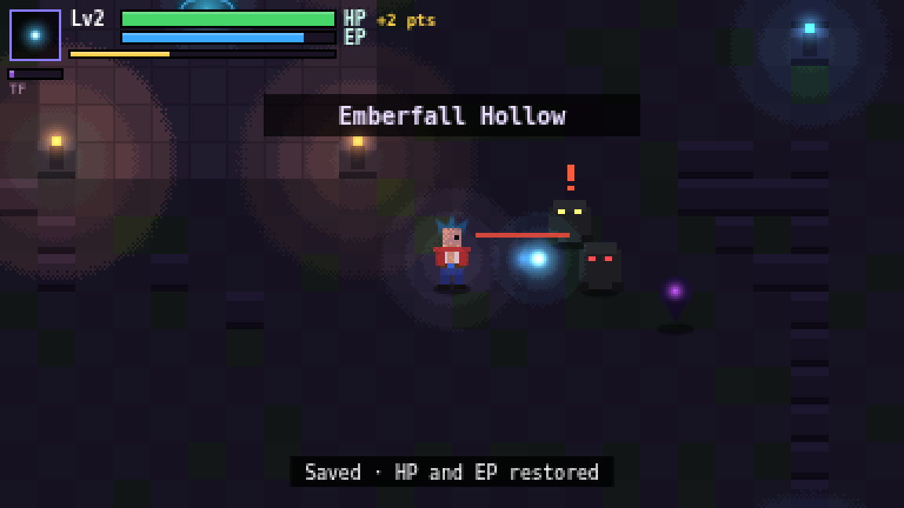

# Ki Quest (working title)
Original top-down GBA-style action RPG (fists, ki blasts, glowing ruins). Original characters, names and world.
Stage 1 · chunk 1: grey-box playable in one area, **Emberfall Hollow**.

```
npm install
npm run dev        # http://localhost:5173
npm run build      # typecheck + dist/ (with offline service worker)
npm run smoke      # Playwright smoke test against the build (add -- --gif for docs/stage1.gif)
```

## Controls
| Action | Keyboard | Gamepad | Touch |
|---|---|---|---|
| Move (8-dir) | WASD / arrows, double-tap to run | Left stick / D-pad, hold X to run | Floating stick (left side), push hard to run |
| Melee combo (3 hits) | J | A | A |
| Ki blast (8 EP) | K | B | B |
| Block (hold) / Energy shield | Shift / Shift+K | RB / RB+B | R / R+B |
| Cycle technique (stub) | Q | LB | L |
| Status / pause | Esc | Start | II icon |
| Map (stub) | M | Select | ▦ icon |


